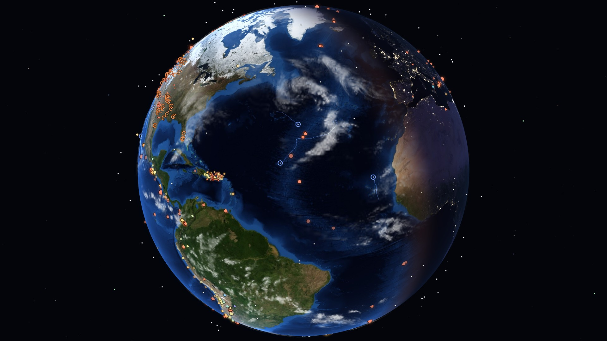
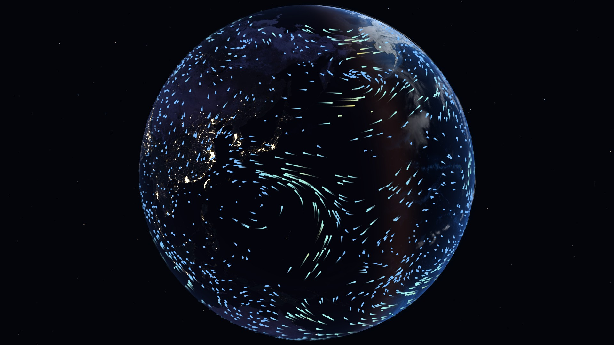
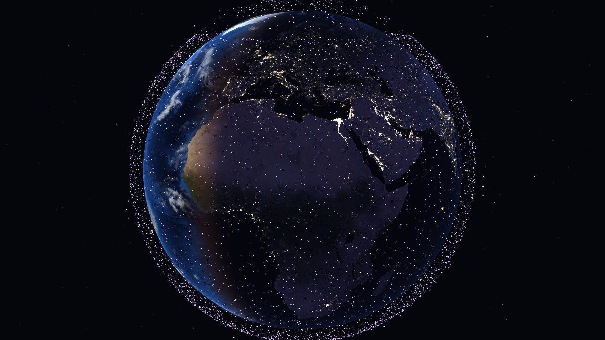
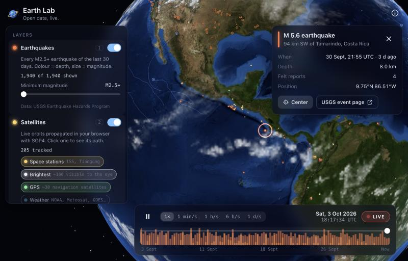

<div align="center">

# 🌍 Earth Lab

**Un globo 3D vivo con datos científicos abiertos — terremotos, satélites, eventos naturales y viento — y una máquina del tiempo para reproducir los últimos 30 días.**

Funciona íntegramente en tu navegador. Sin backend, sin claves de API, sin rastreo.

[](https://github.com/HMJ07/earth-lab/actions/workflows/ci.yml)
[](LICENSE)


[English](README.md) · [Arquitectura](docs/ARCHITECTURE.md) · [Añadir una capa](docs/ADDING_A_LAYER.md) · [Roadmap](docs/ROADMAP.md)



</div>

## ¿Qué es?

Earth Lab reúne varias fuentes públicas de datos científicos en un mismo planeta interactivo y te deja moverte en el tiempo. Mira cómo llega el último mes de terremotos en orden, sigue a la ISS por su órbita, comprueba dónde hay incendios y tormentas activos ahora mismo, o deja que miles de partículas de viento fluyan sobre los océanos.

Todo se calcula en el cliente: las órbitas se propagan con SGP4, la posición del Sol sale de fórmulas astronómicas y el globo se dibuja con shaders GLSL propios.

<table>
  <tr>
    <td width="50%"><br><sub><b>Viento</b> — flujo de partículas sobre un globo atenuado</sub></td>
    <td width="50%"><br><sub><b>Satélites</b> — ~10 000 con Starlink activado</sub></td>
  </tr>
</table>

## Características

| Capa                     | Qué ves                                                                                                                                                     | Fuente                                     |
| ------------------------ | ----------------------------------------------------------------------------------------------------------------------------------------------------------- | ------------------------------------------ |
| 🌋 **Terremotos**        | Todos los eventos M2.5+ de los últimos 30 días. Color = profundidad, tamaño = magnitud, los recientes pulsan.                                               | [USGS](https://earthquake.usgs.gov/)       |
| 🛰️ **Satélites**         | Estaciones espaciales, los más brillantes, GPS, meteorológicos y (opcional) Starlink. Pulsa uno para ver altitud, velocidad, órbita y trayectoria prevista. | [CelesTrak](https://celestrak.org/)        |
| 🔥 **Eventos naturales** | Incendios, tormentas severas (con su recorrido), volcanes, inundaciones y hielo marino.                                                                     | [NASA EONET](https://eonet.gsfc.nasa.gov/) |
| 💨 **Viento**            | Viento en superficie animado, coloreado por velocidad.                                                                                                      | [Open-Meteo](https://open-meteo.com/)      |
| 🌗 **Día / noche**       | Terminador real calculado con la posición del Sol, banda crepuscular y luces de ciudades.                                                                   | calculado                                  |

Además:

- ⏪ **Máquina del tiempo** — arrastra o reproduce hasta **1 día por segundo**. Un gráfico te muestra cuándo pasó cada cosa. Cada instante tiene un enlace para compartir (`#t=…`).
- 🔌 **Capas tipo plugin** — un nuevo conjunto de datos es una clase que implementa una interfaz `Layer` pequeña. Mira [Añadir una capa](docs/ADDING_A_LAYER.md).
- ⚡ **Rápido** — ~10 000 satélites se propagan con un presupuesto de 3 ms por frame; el picking al pasar el ratón sobre todos ellos tarda alrededor de un milisegundo.
- 📱 **Responsive**, controles operables con teclado y respeta `prefers-reduced-motion`.
- 🔒 **Privado** — nada se envía a ningún sitio salvo a las APIs públicas indicadas, directamente desde tu navegador.

<p align="center"></p>

## Inicio rápido

Requiere **Node.js 20+**.

```bash
git clone https://github.com/HMJ07/earth-lab.git
cd earth-lab
npm install
npm run dev
```

Abre <http://localhost:5173>. Para generar la versión de producción: `npm run build` (salida en `dist/`).

### Controles

| Acción                        | Entrada                                    |
| ----------------------------- | ------------------------------------------ |
| Rotar / zoom                  | Arrastrar / rueda o pellizco               |
| Detalles de un marcador       | Clic (pasa el ratón para una vista previa) |
| Activar capas                 | `1` – `4` o los interruptores              |
| Reproducir / pausar el tiempo | `Espacio`                                  |
| Volver al directo             | `L`                                        |
| Auto-rotación                 | `R`                                        |
| Cerrar detalles               | `Esc`                                      |
| Ayuda y créditos              | `?`                                        |

### Enlaces para compartir

El hash de la URL guarda las capas activas y el instante de tiempo:

```
https://<tu-sitio>/#layers=quakes,satellites,events&t=1789755177796
```

## Limitaciones conocidas

Para ser transparentes con lo que los datos pueden y no pueden hacer:

- **La precisión de los satélites decae con el tiempo.** SGP4 es preciso a más o menos un kilómetro cerca de la época del conjunto de elementos y se desvía con los días. Si retrocedes mucho, la tarjeta avisa de que la posición es aproximada.
- **El viento muestra condiciones actuales y es de baja resolución.** Se interpola desde una rejilla de 15° (264 puntos), lo máximo que permite el plan gratuito de Open-Meteo por actualización. Ignora la máquina del tiempo.
- **Las nubes son decorativas.** Una textura estática, no la nubosidad en vivo.
- **Sin vuelos en directo.** Las APIs gratuitas de seguimiento de vuelos (OpenSky, adsb.lol…) no permiten acceso desde el navegador desde otros orígenes. Un proxy está en el [roadmap](docs/ROADMAP.md).
- **Las APIs públicas pueden ser lentas o limitar peticiones.** Las respuestas se cachean (`localStorage`) y se usa una copia antigua si falla la red.

## Cómo funciona

```
src/
├── app/        App.ts (orquestador) · layers.ts (registro de capas)
├── core/       Reloj · interfaz Layer · LayerManager · http+caché · geo · astronomía · estado en URL
├── scene/      Globo y shaders · estrellas · cámara · marcador de selección · picking de puntos
├── layers/     earthquakes · satellites · events · wind   ← una carpeta por conjunto de datos
└── ui/         panel de capas · línea de tiempo · tarjeta de info · HUD · diálogo «acerca de»
```

Algunas decisiones que conviene conocer (detalle en [ARCHITECTURE.md](docs/ARCHITECTURE.md)):

- **Un único reloj lo gobierna todo.** `SimClock` está en _directo_ o corriendo libremente dentro de una ventana de 30 días. Las capas reciben el tiempo simulado en cada frame y nunca tocan `Date.now()`.
- **Viaje en el tiempo en la GPU.** Los terremotos y eventos llevan su marca de tiempo como atributo de vértice; el shader decide qué se ve. Arrastrar la línea de tiempo cuesta un uniform, no una reconstrucción.
- **Propagación de órbitas con presupuesto.** Los satélites se propagan en rotación dentro de un presupuesto de CPU por frame, así que incluso 10 000 mantienen la interfaz fluida.
- **Las capas están aisladas.** El gestor carga cada capa bajo demanda, contiene sus fallos y se ocupa de visibilidad, picking y selección.

## Scripts

| Comando                                 | Qué hace                                       |
| --------------------------------------- | ---------------------------------------------- |
| `npm run dev`                           | Servidor de desarrollo con recarga en caliente |
| `npm run build`                         | Comprobación de tipos + build de producción    |
| `npm run preview`                       | Sirve el build de producción en local          |
| `npm test`                              | Ejecuta los tests unitarios (Vitest)           |
| `npm run typecheck` · `lint` · `format` | TypeScript, ESLint, Prettier                   |
| `npm run check`                         | Todo lo que ejecuta la CI                      |

## Despliegue

El repositorio incluye un workflow de GitHub Actions que compila y publica en **GitHub Pages** con cada push a `main`
(activa _Settings → Pages → Source: GitHub Actions_). Para alojarlo bajo una subruta, define `BASE_PATH`:

```bash
BASE_PATH=/earth-lab/ npm run build
```

Es un sitio estático: sirve cualquier hosting estático (Netlify, Cloudflare Pages, S3…).

## Contribuir

Ideas, reportes de errores y nuevas capas son muy bienvenidos — mira [CONTRIBUTING.md](CONTRIBUTING.md). Una buena primera contribución es una capa nueva; la [guía](docs/ADDING_A_LAYER.md) te lleva por una en ~100 líneas.

## Créditos

Imágenes de la Tierra de la NASA; datos de USGS, CelesTrak, NASA EONET y Open-Meteo; hecho con [three.js](https://threejs.org/) y [satellite.js](https://github.com/shashwatak/satellite-js). Atribución completa y licencias en [CREDITS.md](CREDITS.md).

## Licencia

[MIT](LICENSE) © HMJ07
