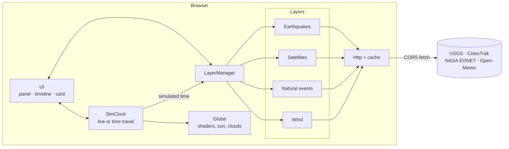

# Architecture

Earth Lab is a static single-page app: TypeScript, [three.js](https://threejs.org/) and hand-written GLSL. There is no UI framework and no backend. This document explains how the pieces fit together and why.

## Overview

`App` (in `src/app/App.ts`) wires everything and runs the render loop. Each frame it does, in order:

1. advance the `SimClock`;
2. update the sun direction and the layers with the simulated time;
3. update camera, selection and UI;
4. render.

## Conventions

**Geometry.** The globe is a unit sphere centred on the origin. `+Y` is the north pole and longitude 0° lies on `+X`, which is how `SphereGeometry` maps an equirectangular texture. The globe never rotates: the _camera_ orbits it, so world coordinates always equal globe coordinates and the Sun is a fixed vector per frame. Conversions live in `core/geo.ts`.

**Colour.** All custom shaders work directly in sRGB. Textures are loaded with `NoColorSpace` and no output conversion is applied, so what the shader writes is what the display shows. Layer colours are passed as 0–1 floats parsed by `core/color.ts` (not `THREE.Color`, which would convert to linear).

**Units.** Altitudes are converted with `altitudeToRadius(km)`: 1 + km / 6371.

## Time model

`SimClock` (`core/Clock.ts`) has three observable states: _live_ (glued to the wall clock), _playing_ from a past instant at a chosen speed, or _paused_. It enforces the invariants that make the UI simple:

- time is always inside `[now - 30 days, now]`;
- playing forward into the present snaps back to _live_;
- seeking within one second of "now" goes _live_.

Layers never read `Date.now()`; they receive `FrameInfo.time`. That is what makes the whole app time-travel for free.

## Layers

A layer implements `Layer` (`core/Layer.ts`). The contract is small on purpose:

| Member                   | When it runs                      | Purpose                                                  |
| ------------------------ | --------------------------------- | -------------------------------------------------------- |
| `load(ctx)`              | once, on first enable             | fetch data, build scene objects, add them to `ctx.group` |
| `update(frame)`          | every frame while enabled         | push time/camera uniforms, advance animations            |
| `pick(query)`            | hover/click                       | nearest item under the pointer                           |
| `status()`               | ~4×/s                             | one-line text under the switch                           |
| `controls?()`            | when the layer becomes ready      | extra UI (sliders, toggles, selects)                     |
| `describe?(id, time)`    | every frame for the selected item | fresh details of something that moves                    |
| `probe?(lat, lon)`       | on hover                          | text for the HUD (e.g. wind speed)                       |
| `activity?(from, to, n)` | a few times per second            | histogram for the timeline sparkline                     |
| `select?(id)`            | selection changes                 | e.g. draw the orbit path                                 |

`LayerManager` owns the lifecycle: `idle → loading → ready | error`. A layer that throws in `load` is put in `error` (with a _Retry_ button) and cannot affect the others. The group of a layer is shown only while it is enabled **and** ready.

### Rendering order

`renderOrder` values keep overlays predictable:

| Object                      | Order |
| --------------------------- | ----- |
| stars                       | -1    |
| Earth                       | 0     |
| clouds                      | 1     |
| atmosphere shell            | 2     |
| wind                        | 8     |
| storm tracks, orbit path    | 9     |
| earthquakes, natural events | 10    |
| satellites                  | 11    |
| selection marker            | 20    |

Markers use normal alpha blending with a dark rim rather than additive blending: additive glows are washed out by the bright daytime imagery, while a rim reads on day and night alike.

## Performance decisions

- **Time-travel on the GPU.** Earthquakes and natural events upload `start`/`end` times as vertex attributes. The vertex shader compares them with a single `uTime` uniform and collapses what is not visible. Scrubbing the timeline never rebuilds a buffer.
- **Budgeted orbit propagation.** `SatelliteLayer` propagates satellites round-robin until a 3 ms budget is spent, then continues next frame. The selected satellite is always propagated exactly. With ~10 000 satellites the cost stays flat; without it, SGP4 for all of them would spike every frame.
- **Cheap picking.** `scene/pointPicking.ts` projects with the pre-multiplied view-projection matrix inline and only runs the (more expensive) occlusion test on candidates inside the radius. Over 10 000 points it takes about a millisecond.
- **Occlusion is exact.** `isOccludedByGlobe` tests the camera→point segment against the unit sphere, so a satellite high above the horizon is correctly pickable even when its sub-point is hidden.
- **Wind is frame-rate independent.** Particles advance in fixed 1/60 s steps (with a cap), so trail length does not change on a 30 Hz display. Trails are plain `Points` with per-vertex alpha and are shifted with `copyWithin` rather than reallocated.
- **Hot paths do not allocate.** Wind sampling writes into a reusable object, picking reuses scratch vectors, and hover picking runs every few frames, not every frame.

## Data access

All network access goes through `core/http.ts`:

- a timeout on every request;
- an in-memory + `localStorage` cache with per-request TTL (CelesTrak asks clients not to poll more than every ~2 h, so element sets are cached for 2 h);
- **stale-on-error**: if the network fails and any cached copy exists, it is served instead;
- a typed `HttpError` so layers can give a human-readable message (for example Open-Meteo's 429).

Every source used must allow cross-origin requests from a browser. This is why live flights are not included: OpenSky and adsb.lol do not.

Links shown in the details card come from third-party feeds and pass through `safeHttpUrl`, which only allows `http(s)`. All text from feeds is inserted with `textContent`; `innerHTML` is used only for static icon strings.

## Testing

Pure logic is unit-tested with Vitest (`npm test`): coordinate maths, the sun's position, the clock, HTTP caching, URL state, every data parser (USGS, EONET, TLE, Open-Meteo), orbit propagation against a known ISS element set, wind interpolation, picking and the layer manager. Shaders and WebGL are verified visually; the quickest check is `npm run dev` and a look at the globe.

CI (`.github/workflows/ci.yml`) runs typecheck, lint, format check, tests and a production build on every push and pull request. The example in `docs/examples/` is part of the type-check.

## Trade-offs

| Decision                     | Why                                                                                   | Cost                                                                    |
| ---------------------------- | ------------------------------------------------------------------------------------- | ----------------------------------------------------------------------- |
| No UI framework              | The UI is small and mostly driven by the render loop; plain DOM keeps the bundle lean | Hand-written DOM helpers (`ui/dom.ts`)                                  |
| TLE text instead of OMM JSON | ~3× smaller, which matters for Starlink                                               | Fixed-width parsing                                                     |
| Coarse wind grid             | Fits Open-Meteo's free tier (each coordinate counts as a call)                        | Less detail than a numerical weather model                              |
| Static cloud texture         | Live cloud imagery needs tiles or a backend                                           | Clouds are decorative                                                   |
| One shared clock             | Everything stays consistent                                                           | Layers that are not time-aware (wind) must say so (`timeAware = false`) |
